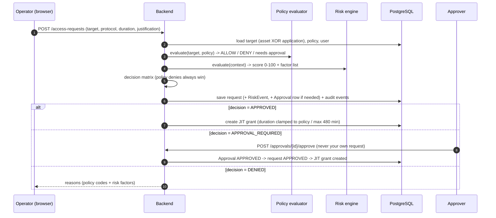

# SecurePAM — current architecture and end-to-end flow

Snapshot of 15 Oct 2026, written from the code in this repository and from the running system (not from the original
design documents). Every statement is marked by how sure it is:

- **Live** — running right now on this Mac.
- **In the working tree, not yet live** — written and tested, uncommitted, but the running processes have not been restarted onto it.
- **Not implemented** — does not exist; stated so nobody assumes it does.

Companion documents: `docs/SECUREPAM-STARTUP-RUNBOOK.md` (start/status scripts), `~/.securepam/openbao/RUNBOOK.md`
(OpenBao operations), `~/securepam-backups/pre-activation-*/RESTORE.md` (backups).

---

## 1. What SecurePAM is

A **privileged access management** platform. Nobody connects to a server or an internal web app directly. A person asks
for access, the system decides (policy + explainable risk score + human approval when needed), grants a **time-boxed
just-in-time (JIT) grant**, and then SecurePAM itself opens the connection on their behalf — fetching the credential from
a vault the user never sees, relaying the session through a gateway, recording it, and cutting it off the instant the
grant ends. Every step is audited.

```
authenticate -> authorize (RBAC) -> request -> policy + risk -> approval (if required)
   -> JIT grant -> credential checkout (vault) -> gateway session (SSH / RDP / isolated browser)
   -> recording + live monitoring -> expiry / revoke / terminate -> audit trail + Risk Centre
```

Two principles run through everything:

1. **Identity and authorization are separate.** Keycloak (or the dev login) only answers *who is this?*. What they may do
   is always decided by SecurePAM's own RBAC tables; roles claimed inside a token are never trusted.
2. **Fail closed.** Missing recording, sealed vault, expired grant, unknown SSH host key, unexpected destination — each one
   stops the session rather than degrading silently.

---

## 2. The system at a glance

```
                          OPERATOR / APPROVER / AUDITOR / ADMIN  (browser)
                                            |
              +-----------------------------+-----------------------------+
              |                                                           |
   Frontend :3001 (React/Vite)                                  Frontend :3002 (React/Vite)
   dev username+password login                                  Keycloak login + OTP (MFA)
              | REST /api/v1  + WebSocket                                  | REST + WebSocket
              v                                                           v
   Backend :8001 (FastAPI)                                      Backend :8002 (FastAPI)
   DEV_MODE=true                                                DEV_MODE=false (OIDC)
   OpenBao: STAGING :18210                                      OpenBao: legacy DEV :18200 (see 10)
              |                                                           |
              +------------------------+----------------------------------+
                                       |   (both talk to the same shared services)
        +------------+-------------+---+----------+--------------+-------------------+
        |            |             |              |              |                   |
   PostgreSQL     Redis       OpenBao        Keycloak        guacd :4822     Browser-isolation
   :5432 (host)  :6379 (host) :18210 TLS     :8080 + its     (Guacamole      daemon :6090
   system of     rate limit,  Raft, Shamir   own Postgres    protocol proxy  (container: Xvfb +
   record        one-time     3/2, KV v2     MFA realm +     for RDP)        Chromium + x11vnc +
                 session      credentials    OTP listener         |          egress proxy)
                 tickets                                          v                  |
                                                            Windows target     registered web app
                                          SSH target (Kali) <---- asyncssh from the backend
```

Everything binds to **127.0.0.1**. There is no production web server in front: the frontends are Vite dev servers.

### Components and where they run (verified)

| Component | Port | How it runs | Role |
|---|---|---|---|
| Frontend A | 3001 | host process (`npm run dev`) | React app against backend 8001 (dev login) |
| Frontend B | 3002 | host process | React app against backend 8002 (Keycloak + MFA) |
| Backend A | 8001 | host process (`uvicorn`, venv) | FastAPI control plane + gateways, `DEV_MODE=true` |
| Backend B | 8002 | host process | same code, `DEV_MODE=false`, validates Keycloak tokens |
| PostgreSQL 16 | 5432 | Homebrew service `postgresql@16` | **the** SecurePAM database |
| Redis | 6379 | Homebrew service `redis` | rate limiting, one-time session tickets |
| OpenBao (staging) | 18210 | macOS LaunchAgent `local.securepam.openbao` | secret store: TLS, Raft storage, Shamir seal (3 shares, 2 needed), file audit |
| Keycloak 24 + custom OTP listener | 8080 | Docker `securepam-keycloak` | identity, password + TOTP MFA |
| Keycloak database | — | Docker `securepam-keycloak-postgres` (volume) | Keycloak's persistent store |
| guacd 1.6 | 4822 | Docker `guacamole-guacd-1` | speaks RDP; backend drives it over the Guacamole protocol |
| Guacamole web + DB | 8081 | Docker `guacamole-guacamole-1`, `…-guac-postgres-1` | auxiliary: not in SecurePAM's request path |
| Browser-isolation daemon | 6090 (+5910-5917 VNC) | Docker `browser-isolation-browser-isolation-1` | disposable hardened browsers |
| OpenBao (legacy dev) | 18200 | hand-started `bao server -dev` | in-memory; only backend 8002 still points at it |
| Docker trial stack | 3010/8010/… | Docker `securepam-*` | an earlier containerized trial; unused by 3001/8001 and 3002/8002 |

Ports **3000 and 8000 belong to a different project** and are never touched.

---

## 3. Code layout

```
backend/app
  main.py            app factory, middleware, background loops, first-boot seeding (DEV_MODE only)
  api/v1/            thin HTTP/WebSocket routes (auth, assets, applications, policies, access_requests,
                     approvals, sessions, ssh_sessions, rdp_sessions, web_sessions, recordings, audit, risk,
                     credential_refs, asset_credentials, jit_grants, session_admin, users, dashboard,
                     system_settings, health)
  services/          the real logic: access_decision, jit_service, credential_service, credential_provisioning,
                     session_policy, session_termination, ssh_* , rdp_* , guacamole, browser_isolation,
                     terminal_recorder, command_transcript, recording_reconciler, risk_detector,
                     keycloak_mfa_sync, rdp_controls
  auth/              TokenValidator abstraction: dev_provider (HS256 JWT) and oidc_provider (Keycloak, RS256/JWKS)
  secret_providers/  OpenBao reader (GET) and writer (POST) as separate identities; mock for tests
  policies/ risk/    policy evaluator and the deterministic risk engine (kept apart on purpose)
  core/              config, deps (PermissionChecker), audit writer, SIEM sink, rate limiter, SSRF guard, logging
  models/ schemas/   SQLAlchemy models, Pydantic schemas
frontend/src         pages/, components/ (SshTerminal, RdpClient, WebClient, players), auth/, api/, hooks/
infrastructure/      browser-isolation (daemon + Chromium policy), guacamole, keycloak, openbao
keycloak-extension/  Java event listener "securepam-otp-audit"
policy-engine/       a standalone, versioned policy-decision package — NOT imported by the backend today
scripts/ docs/       start/status scripts, runbooks
```

Routes are deliberately thin: `access_requests.py` only translates HTTP to `AccessDecisionService`; `ssh_sessions.py`,
`rdp_sessions.py` and `web_sessions.py` orchestrate sessions but call the shared services for every security decision.

---

## 4. Authentication and authorization

### 4.1 Two login modes (one codebase)

| | Backend 8001 / Frontend 3001 | Backend 8002 / Frontend 3002 |
|---|---|---|
| Mode | `DEV_MODE=true` (only allowed when `ENVIRONMENT` is development/test) | `DEV_MODE=false` |
| Login | `POST /api/v1/auth/login` with username + password -> HS256 JWT (1 h) | frontend redirects to Keycloak (`keycloak-js`), password **then TOTP** |
| Token check | `DevTokenValidator` | `OIDCTokenValidator`: RS256, signing keys from Keycloak's JWKS (`KEYCLOAK_INTERNAL_URL`) |
| Who is the user | `users.username` | token `sub` must equal `users.external_id` (no auto-provisioning) |
| Which button shows | username/password form | "Sign in with Keycloak" |

The frontend asks the backend `GET /api/v1/auth/config` (public). `dev_mode:true` selects the local form; otherwise it
receives the Keycloak URL, realm and client id and redirects.

### 4.2 Keycloak MFA (verified)

Realm `securepam`, browser flow **"SecurePAM Browser MFA"**: username/password REQUIRED, OTP REQUIRED for users with TOTP
configured; the `CONFIGURE_TOTP` default action forces enrolment. The client `securepam-app` is public (redirect URIs for
3000/3010/3002). Persistence is a **Postgres container** (`securepam-keycloak-postgres`, volume
`securepam_keycloak_postgres_data`) holding realms, users, TOTP seeds and signing keys.

A small Java provider (`keycloak-extension`, event listener `securepam-otp-audit`) logs `SECUREPAM_MFA_FAILURE` for a bad
OTP. A backend loop (`keycloak_mfa_sync`) can import those events with a read-only service account
(`securepam-audit-reader`) as `MFA_FAILURE` audit rows that feed the Risk Centre. **That loop is off by default
(`KEYCLOAK_MFA_SYNC_ENABLED`) and is not enabled on the running backends.**

### 4.3 RBAC (verified from the live database)

Roles are data in `roles` / `permissions` / `role_permissions` / `user_roles`; each route declares `PermissionChecker(resource, action)`.

| Role | Can do |
|---|---|
| **ADMIN** | everything (users, roles, assets, applications, policies, vault references, sessions incl. terminate, recordings, audit, settings) |
| **OPERATOR** | read assets/applications, create access requests, read **own** requests/sessions, start sessions |
| **APPROVER** | read requests/policies/risk, approve or reject |
| **AUDITOR** | read audit, sessions, recordings, requests, risk; export audit |

Own-scope callers get **404** (not 403) for someone else's object so existence is not confirmed.

---

## 5. The access workflow (the heart of the product)

All of it runs in one service, `AccessDecisionService`; the route only translates HTTP.



### 5.1 Policy (`policies/evaluator.py`)
One target against one policy (or a fail-safe default). A policy can restrict **roles, asset types, environments,
protocols, days of week, business hours**, and carries flags: `require_approval`, `jit_required`, `require_mfa`,
`require_recording`, `max_session_duration`, `auto_approve`, `deny_access`, plus `clipboard/download/upload_allowed`.
Output is structured and explainable. (`require_mfa` is *recorded* on the request; it is not re-verified at credential
checkout.)

### 5.2 Risk (`risk/engine.py`) — deterministic, not ML

Same inputs always give the same score; every factor carries a code, points and a plain-language reason; the score equals
the sum. Weights are this project's own and overridable by `RISK_*` settings.

| Factor | Points | Factor | Points |
|---|---|---|---|
| PRODUCTION_ASSET | +30 | OUTSIDE_BUSINESS_HOURS | +20 |
| CRITICAL_ASSET | +25 | UNKNOWN_CONTEXT (no source IP) | +20 |
| HIGH_CRITICALITY | +15 | REPEATED_AUTH_FAILURE | +20 |
| SENSITIVE_APPLICATION | +20 | UNUSUAL_ACCESS_PATTERN (first request) | +20 |
| HIGH_PRIVILEGE_ROLE | +20 | LONG_DURATION (> 60 min) | +10 |

Levels: **LOW 0–29, MEDIUM 30–59, HIGH 60–79, CRITICAL 80+**.

### 5.3 Decision matrix
Policy denies -> **DENIED**, always. CRITICAL risk -> DENIED without a policy, otherwise elevated APPROVAL_REQUIRED.
HIGH -> APPROVAL_REQUIRED. LOW/MEDIUM -> whatever the policy says.
State machine: `PENDING -> APPROVAL_REQUIRED -> APPROVED -> ACTIVE -> EXPIRED` (also DENIED, REJECTED, CANCELLED);
invalid transitions raise; **self-approval is blocked**.

### 5.4 JIT grants (`jit_service.py`)
The only place expiry is computed (default 30 min, hard max 480, never above the policy/decision ceiling). `validate()` is
the **single authority** on "is this grant live?" — gateways call it; no UI timer decides anything. Grants die by expiry,
or an admin revokes one (`jit_grants.py`), which also ends every live session it authorised.

---

## 6. Secrets: OpenBao and the credential lifecycle

### 6.1 The vault (staging, verified)
- `https://127.0.0.1:18210`, **TLS 1.2+** with a local CA (`~/.securepam/openbao/tls/ca.crt`, verified strictly by the backend).
- **Raft** single-node storage in `~/.securepam/openbao/data/raft`; **Shamir 3 shares, threshold 2**; unseal is manual after every restart.
- File **audit device** (`audit/audit.log`, mode 0600). Started by the LaunchAgent with `KeepAlive`.
- KV v2 mount `secret/`, credentials at `secret/securepam/assets/<name>` (`kali`, `win11-lab`).
- Three policies: **securepam-read** (read those two paths), **securepam-writer** (create/update the same two), and a deliberately
  minimal **securepam-admin** (mint/revoke the two application tokens, `sys/capabilities`, a self-test path, raft snapshots —
  no access to real credentials, no root). Application tokens are 30-day, non-renewable, orphan, in `~/.securepam/openbao/tokens/`.

### 6.2 How a credential is stored and bound
An admin enters a username/password in the GUI (`PUT /assets/{id}/credential`). The backend **writes** it with the writer
token (`POST /v1/secret/data/securepam/assets/<name>`), reads it back with the reader token to verify, then records only a
**reference** in `vault_refs` (path, provider, username, version) — never the secret. One reference belongs to at most one
live asset; only an allow-list of names is accepted (`kali`, `win11-lab`). The reader and writer are separate identities and
the backend refuses to start if they are the same token.

### 6.3 How a credential is used (`CredentialService.checkout`)
Backend-only, never an HTTP endpoint. In order, or it refuses (fail closed): user active and holding `sessions:create` ->
request is the user's own, ACTIVE, approved if approval was needed -> asset enabled and ACTIVE -> JIT grant bound to the same
request/user/asset/protocol and **live** -> session bound to the same ids -> exactly one active reference for the configured
provider. Only then does it read OpenBao. The secret is handed to the protocol handshake, then **wiped**. Audit:
`CREDENTIAL_RETRIEVAL_ATTEMPTED` -> `RETRIEVED` / `DENIED` / `FAILED`.

---

## 7. Sessions — one launch pattern, three gateways

### 7.1 Common pattern (SSH, RDP and web are identical in shape)

```mermaid
sequenceDiagram
    autonumber
    participant B as Browser (xterm / guacamole / noVNC)
    participant API as Backend
    participant R as Redis
    participant V as OpenBao
    participant G as Gateway (asyncssh / guacd / isolation daemon)
    participant T as Target
    B->>API: POST /sessions/{ssh|rdp|web}/launch {request, asset}
    API->>API: check RBAC, ACTIVE request, live JIT grant, concurrent-session cap (2)
    API->>V: SSH/RDP only: pre-check the credential can be checked out (web sessions use no stored credential)
    API->>R: mint one-time ticket (60 s, 256-bit, bound to session/user/asset/request/grant)
    API-->>B: session id + ticket + ws_url
    B->>API: WebSocket; FIRST frame {type:auth, ticket}   (never in the URL)
    API->>R: redeem ticket (atomic GETDEL = single use)
    API->>API: re-validate user, asset, request, grant from the database
    API->>V: SSH/RDP only: credential checkout (6.3)
    API->>G: connect to target with the credential (secret stays server-side)
    G->>T: SSH / RDP / HTTP(S)
    loop every second
        API->>API: re-validate grant, user, asset; enforce expiry / revoke / terminate
    end
    Note over API,B: on end: close gateway, finalize + hash recording, mark session, audit
```

Session states: `STARTING -> ACTIVE -> COMPLETED | TERMINATED | FAILED | EXPIRED` (with `TERMINATING` while a close is
in progress). The concurrent cap (default 2 per user, changeable by an administrator in Settings) is enforced with a row lock so simultaneous launches
cannot slip past it. Termination never claims success it did not achieve: the session stays `TERMINATING` if the gateway
could not be closed, and a recording is only `COMPLETED` if it really exists and was hashed.

### 7.2 SSH (Kali) — `ssh_sessions.py`, `ssh_terminal_gateway.py`
Browser terminal = **xterm.js** over the WebSocket. The backend opens the real connection with **asyncssh** and a PTY.
- **Host-key trust is pinned and fail-closed** (`ssh_host_key.py`): the target's key must be in an OpenSSH `known_hosts`
  file (`~/securepam-data/ssh/known_hosts`); no trust-on-first-use, verification can never be switched off. The file is read
  once and cached for the life of the process.
- **Recording:** asciicast v2 (`terminal_recorder.py`) — output and resizes only, **no keystrokes**; file created O_EXCL, mode 0600,
  SHA-256 + size + duration stored.
- **Transcript** (`command_transcript.py`): typed lines paired with the output that followed, redacted best-effort; explicitly
  *observed input, not proof of execution*.

### 7.3 RDP (Windows) — `rdp_sessions.py`, `rdp_gateway.py`, `guacamole.py`
The backend speaks the **Guacamole protocol to guacd** over TCP and relays the instruction stream to the browser
(`guacamole-common-js`). The credential is passed to guacd in the handshake and never leaves the server.
- **Recording** is guacd's own screen recording into `~/securepam-data/recordings/rdp/<session_id>/recording` (a bind
  mount shared with the backend). A required recording **must exist before any desktop frame is shown**; afterwards it is
  inspected (well-formed stream *with display frames*), SHA-256 hashed, and only then `COMPLETED`.
- **Browser input** is filtered to an allow-list of opcodes (`key, mouse, touch, size, clipboard, blob, end, ack, sync, nop`).
- Live today: NLA security; audio disabled; keystrokes not recorded. **`RDP_IGNORE_CERT=true`: the Windows host's TLS certificate is not validated** (lab setting; a known weakness).
- **In the working tree, not yet live:** default-deny clipboard / file transfer / printing (`rdp_controls.py`, guacd 1.6
  parameter names verified against the running guacd), a gateway clipboard gate with count-only audit
  (`RDP_CLIPBOARD_ACTIVITY`), and `client-name` set to the session number (`SES-xxxxx`) for correlation with Windows logs
  (whether Windows records it is unverified).

### 7.4 Isolated browser — `web_sessions.py`, `browser_isolation.py`, `infrastructure/browser-isolation`
For HTTP/HTTPS **applications**. The destination is always the server-side application record; nothing in a request can change it.
- The daemon (own hardened container: non-root, read-only root fs, all capabilities dropped) runs **one Xvfb + Chromium kiosk +
  x11vnc + egress proxy per session**. The proxy allows only the registered host:port (IP pinned at start; loopback,
  link-local and metadata ranges always blocked); a navigation to any other origin is a violation.
- The backend **terminates the VNC handshake itself**, so the browser's **noVNC** gets an already-authenticated stream and
  never learns the password. Browser-to-VNC traffic is filtered to input and display negotiation; clipboard only if the
  application allows it.
- Chromium managed policy: downloads blocked, printing/DevTools off, `file://` and `chrome://` blocked, extensions blocked.
- A session is ACTIVE only after the daemon reports the registered page loaded **and** the relay is up. Violations are audited.
- Only applications with `access_mode = ISOLATED_BROWSER` launch. **`STANDARD_PROXY` (a reverse-proxy gateway) is not implemented.**
- **Not implemented:** browser session recording (a session whose request or application requires recording is refused),
  and an activity/URL log of allowed navigations.

---

## 8. Recording, evidence and monitoring

| | SSH | RDP | Isolated browser |
|---|---|---|---|
| Lifecycle audit events | yes | yes | yes |
| Recording | asciicast (`.cast`) | Guacamole screen stream | **none** |
| Integrity | SHA-256, verified on every playback | same | — |
| Transcript / activity log | command transcript (best-effort) | **none** (needs Windows telemetry, below) | violations only |
| Playback in the GUI | `CastPlayer` | `RdpRecordingPlayer` | — |

- **Recording reconciler** (every 60 s): a recording still pending/recording after its session ended is marked **FAILED** with an audited reason — it never invents `COMPLETED`.
- Recordings are served only through the API (never a static path), each view is audited, and a hash mismatch refuses playback.
- **Windows command attribution** (Security 4688, PowerShell 4104, Sysmon) is **not integrated**; a screen recording does not prove which commands ran.
- Files live under `~/securepam-data/recordings/` (durable). **63 of the 68 recording rows in the database point to files lost before the 15 Oct backup**; no copy exists.

---

## 9. Audit, SIEM and the Risk Centre

- **Audit log** (`audit_logs`): every privileged action — decisions, approvals, grants, credential events, session lifecycle,
  recording views, permission denials. Rule enforced in code: never put a secret in the metadata.
- **SIEM sink** (`core/siem.py`): one secret-scrubbed JSON line per audit event to `SIEM_EVENT_LOG_PATH`, meant to be tailed by
  a Wazuh agent. **Not enabled on the running backends** (path unset).
- **Risk Centre** (`risk_detector.py`, evaluated every 5 min): deterministic, evidence-carrying findings from SecurePAM's own
  records — MFA failures, repeated launch denials, credential retrieval denied/failed, broken credential references, failed
  recordings, and similar. Each finding lists the audit rows behind it.
- **Background loops** (backend, `ENVIRONMENT != test`): recording reconciler + Risk Centre (every 60 s / 5 min); optional MFA sync.
- **Rate limiting:** Redis-backed; defaults are 60 requests/min and 10/min for auth endpoints (`RATE_LIMIT_*`), answered with HTTP 429. (The GUI's polling tripped it once during testing.)
- **Health:** `/health/ready` (database + Redis), `/health/detailed` (authenticated: vault, gateways, recording storage, SIEM).

---

## 10. Data model (PostgreSQL: 20 application tables + `alembic_version`)

```
users ──< user_roles >── roles ──< role_permissions >── permissions
users ──< access_requests >── assets | applications ──> policies
access_requests ──< approvals            access_requests ──< risk_events
access_requests ──< jit_grants           jit_grants ──> assets | applications
sessions ──> users, access_requests, jit_grants, assets | applications, recordings
sessions ──< session_events              recordings ──> sessions   (hash, size, status, file_path)
assets | applications ──< vault_refs     (reference only: path, provider, username, version)
audit_logs ──> users, access_requests, sessions
risk_findings ──> users, assets | applications, sessions     notifications ──> users     app_settings
```
Migrations are Alembic (current head `d4e5f6a7b8c9`). In `DEV_MODE` the first boot creates tables and seeds roles,
permissions, four dev users and default policies (sample targets are off).

---

## 11. Frontend

React + TypeScript + Vite + Tailwind; **TanStack Query** for server state, **axios** client (Bearer token from the dev
login or Keycloak), React Router. Pages: Dashboard, Access Requests (+ new / detail), Approvals, Sessions (own), Admin
Sessions, Assets, Applications, Policies, Vault References, Recordings (+ transcript), Audit Logs, Risk Centre, Users, Roles,
Settings. Protocol clients: `SshTerminal` (xterm.js), `RdpClient` (guacamole-common-js), `WebClient` (noVNC), players
`CastPlayer` / `RdpRecordingPlayer`. 401 clears the token and returns to `/login`; the API base URL is `VITE_API_URL`
(8001 for 3001, 8002 for 3002).

---

## 12. Security controls, summarised

| Area | Control |
|---|---|
| Identity | OIDC with password + TOTP; dev login only in dev/test environments |
| AuthZ | local RBAC only, token roles ignored; per-route permission checks; own-scope 404 |
| Decisions | policy + deterministic risk, policy denials absolute, self-approval blocked |
| Time | JIT grants clamped and re-validated every second by every gateway |
| Credentials | in OpenBao only; reference in DB; backend-only checkout; wiped after the handshake; separate read/write identities |
| Transport | loopback-only services; strict TLS to OpenBao; Guacamole/noVNC streams terminated server-side |
| Sessions | one-time 60 s ticket in the first WebSocket frame, bound to ids; concurrency cap with row lock |
| SSH | pinned host keys, fail-closed |
| Web | server-side destination, IP-pinned egress proxy, hardened container, Chromium policy |
| Evidence | O_EXCL 0600 files, SHA-256 on every playback, reconciler never promotes to COMPLETED |
| API | strict security headers, request ids, uniform error envelope, rate limiting, SSRF guard on registered applications |

---

## 13. Operations

- **Start / status:** `./scripts/start-securepam.sh` (idempotent; starts only what is stopped) and `./scripts/status-securepam.sh`
  (read-only). Details and caveats: `docs/SECUREPAM-STARTUP-RUNBOOK.md`.
- **After a Mac restart:** PostgreSQL, Redis, the OpenBao LaunchAgent and the Guacamole/isolation containers return by themselves;
  OpenBao is **sealed** (needs 2 of 3 shares); Keycloak, its database and the four app processes need the start script.
- **Backups:** `~/securepam-backups/pre-activation-20261015-194827/` (host database, Keycloak and Guacamole databases, OpenBao
  Raft snapshot + config + TLS + tokens, recordings, host keys, browser-isolation image, git patch, env files). Copy it to
  encrypted storage off this Mac — nothing is off-Mac yet.

---

## 14. Live state versus pending, and known gaps

**Tested, uncommitted, not yet live on the running processes:**
RDP clipboard/file-transfer default-deny and clipboard audit; RDP `client-name`; browser-isolation upload block
(`AllowFileSelectionDialogs`, needs an image rebuild); the real isolation-daemon health probe (`gateway_web`). The credential-
reference fix (deleted assets no longer hold references) **is** live on backend 8001 (not on 8002).

**Not implemented:** isolated-browser recording and activity log; STANDARD_PROXY web gateway; RDP transcript and Windows
event correlation (4688/4104/Sysmon); `require_mfa` re-verification at checkout; the standalone `policy-engine` in the request path.

**Operational gaps:** RDP does not validate the Windows host certificate (`RDP_IGNORE_CERT=true`); backend 8002's secret store is the hand-started in-memory dev OpenBao on 18200 (lost on reboot);
the Keycloak MFA sync and the SIEM sink are configured in code but not enabled; the browser-isolation and Keycloak custom
images are not archived (Keycloak's is rebuildable); single-node OpenBao on one Mac is a single point of failure; the
Guacamole snapshot/Raft restore has never been restore-tested.

---

## 15. Where to look in the code

| Question | File |
|---|---|
| How is a request decided? | `services/access_decision.py`, `policies/evaluator.py`, `risk/engine.py` |
| Is this grant still valid? | `services/jit_service.py` |
| How does a session start/stop? | `api/v1/{ssh,rdp,web}_sessions.py`, `services/session_termination.py`, `services/session_policy.py` |
| How is a credential fetched? | `services/credential_service.py`, `secret_providers/openbao.py`, `…/writer.py` |
| Why was a recording failed? | `services/rdp_recording.py`, `services/recording_reconciler.py`, `services/terminal_recorder.py` |
| What does each role see? | `main.py` (`_seed_default_data`), `core/deps.py` |
